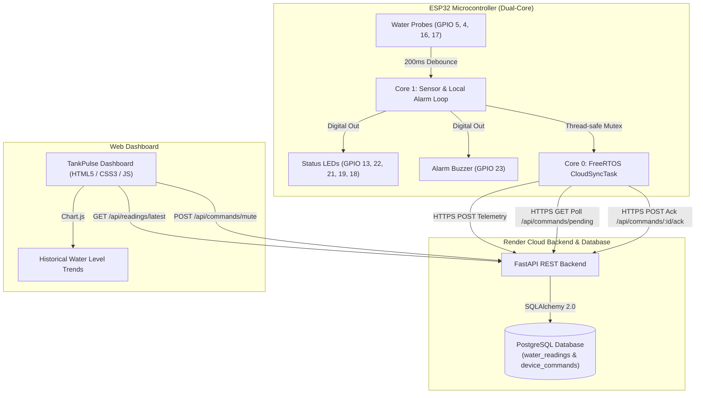

# TankPulse — ESP32 Smart Water Tank Monitoring System

TankPulse is an end-to-end, production-grade Internet of Things (IoT) system designed for real-time water storage monitoring, visual telemetry analytics, and bidirectional remote buzzer silence control.

The system connects an ESP32 microcontroller with a physical 4-probe sensor array to an asynchronous FastAPI backend deployed on Render, backed by PostgreSQL, with an interactive cloud web dashboard and FreeRTOS-powered background synchronization.

---

## 1. System Architecture



---

## 2. Hardware Pinout & Wiring Specifications

> [!IMPORTANT]
> The physical hardware assignments and electrical specifications are strictly fixed. Do not alter GPIO pin assignments or pull-up configurations.

| Component | ESP32 GPIO | Mode / State | Electrical Logic |
| :--- | :--- | :--- | :--- |
| **Probe 25%** | `GPIO 5` | `INPUT_PULLUP` | `LOW` = Submerged (Filled) / `HIGH` = Dry (Empty) |
| **Probe 50%** | `GPIO 4` | `INPUT_PULLUP` | `LOW` = Submerged (Filled) / `HIGH` = Dry (Empty) |
| **Probe 75%** | `GPIO 16` | `INPUT_PULLUP` | `LOW` = Submerged (Filled) / `HIGH` = Dry (Empty) |
| **Probe 100%** | `GPIO 17` | `INPUT_PULLUP` | `LOW` = Submerged (Filled) / `HIGH` = Dry (Empty) |
| **LED 1 (< 25%)** | `GPIO 13` | `OUTPUT` | `HIGH` when tank is 0% (Critical Empty) |
| **LED 2 (25–50%)** | `GPIO 22` | `OUTPUT` | `HIGH` when water reaches 25% |
| **LED 3 (50–75%)** | `GPIO 21` | `OUTPUT` | `HIGH` when water reaches 50% |
| **LED 4 (75–100%)** | `GPIO 19` | `OUTPUT` | `HIGH` when water reaches 75% |
| **LED 5 (100% Full)** | `GPIO 18` | `OUTPUT` | Blinks continuously when tank is 100% full |
| **Alarm Buzzer** | `GPIO 23` | `OUTPUT` | Sounds on 0% (Empty) and 100% (Overfill Warning) |

---

## 3. REST API Specification

### A. Sensor Telemetry Endpoints

| Method | Endpoint | Auth Required | Description |
| :--- | :--- | :---: | :--- |
| `GET` | `/health` | None | Returns backend status and tests PostgreSQL connectivity. |
| `POST` | `/api/readings` | None (Optional `X-Device-Key`) | Ingests sensor reading from ESP32. |
| `GET` | `/api/readings/latest` | None | Retrieves latest reading serialized in Indian Standard Time (IST, `+05:30`). |
| `GET` | `/api/readings/history` | None | Retrieves paginated historical readings (supports `limit=1..500`). |

### B. Remote Buzzer Control Endpoints (Bidirectional)

| Method | Endpoint | Auth Header | Description |
| :--- | :--- | :---: | :--- |
| `POST` | `/api/commands/mute` | `X-Dashboard-Token` | Queues a `MUTE_ALARM` command (`PENDING`) to silence the physical buzzer. |
| `GET` | `/api/commands/pending` | `X-Device-Key` | Polled by ESP32 (every 3s) for pending commands. Stale commands (>120s) expire automatically. |
| `POST` | `/api/commands/{id}/ack` | `X-Device-Key` | Acknowledges physical execution on ESP32 (`ACKNOWLEDGED`). Enforces device ownership. |
| `GET` | `/api/commands/status/{id}` | `X-Dashboard-Token` | Polled by dashboard to verify whether hardware acknowledged muting. |
| `GET` | `/api/commands/history` | `X-Dashboard-Token` | Retrieves audit log of recent commands for the activity timeline. |

---

## 4. Production Security Architecture

1. **Dashboard Operator Authorization (`DASHBOARD_CONTROL_TOKEN`)**:
   - Web operators enter their token via the dashboard Settings modal.
   - Verified on the backend using constant-time string comparison (`hmac.compare_digest`).
   - Missing token configuration on the server returns `HTTP 503 Service Unavailable`.
   - Invalid token returns `HTTP 401 Unauthorized`.
2. **ESP32 Hardware Authentication (`ESP32_API_KEY`)**:
   - Pre-shared secret configured in `esp32/secrets.h` (`deviceApiKey`).
   - Transmitted in the `X-Device-Key` HTTPS header.
   - Enforced on telemetry ingestion (POST /api/readings) as well as command polling and acknowledgement endpoints.
3. **Production Bypass Immunity**:
   - In production (`ENVIRONMENT=production` or running on Render), `ALLOW_INSECURE_DEV_AUTH` is strictly ignored and blocked.
4. **Command Time-To-Live (TTL)**:
   - Commands older than 120 seconds are automatically marked `EXPIRED` to prevent stale commands from muting the buzzer upon device reconnection.
5. **No Secret Leakage**:
   - API tokens and Wi-Fi credentials are never printed to Serial Monitor logs or embedded in client-side HTML/JS.

---

## 5. Production Deployment Guide (Render)

### Step 1: Configure Environment Variables in Render

In your Render Service Dashboard (**Settings** $\to$ **Environment Variables**), set:

| Variable | Recommended Value | Purpose |
| :--- | :--- | :--- |
| `ENVIRONMENT` | `production` | Enforces production security checks. |
| `DATABASE_URL` | *(Render Internal PostgreSQL URL)* | Connection string to existing `water_tank` database. |
| `DASHBOARD_CONTROL_TOKEN` | `<Generate-Secure-Random-Token>` | Passphrase for operators to silence buzzer from dashboard. |
| `ESP32_API_KEY` | `<Generate-Secure-Random-Key>` | Hardware key matching `deviceApiKey` in `secrets.h`. |
| `COMMAND_TTL_SECONDS` | `120` | Command expiration window (seconds). |
| `PORT` | `8000` | Port for FastAPI / Uvicorn server. |

### Step 2: Safe Database Migration

The migration is non-destructive and preserves all historical `water_readings` data:

1. **Automatic Initialization**:
   When the FastAPI backend starts, `Base.metadata.create_all()` automatically creates the `device_commands` table if it does not already exist. Existing `water_readings` records are never modified or reset.
2. **Manual SQL Verification (Optional)**:
   You can verify or apply the SQL migration directly to PostgreSQL via `psql`:
   ```bash
   psql "$DATABASE_URL" -f backend/migrations/001_create_device_commands.sql
   ```

### Step 3: Deploy Backend & Dashboard

1. Merge your reviewed Pull Request into `main`.
2. Trigger deployment in the Render Dashboard (or allow auto-deploy on git push).
3. Verify that `GET https://tankpulse-2sq4.onrender.com/health` returns:
   ```json
   {"status":"ok","database":"connected"}
   ```

---

## 6. ESP32 Flashing Instructions

1. **Configure Credentials in `esp32/secrets.h`**:
   ```cpp
   #ifndef SECRETS_H
   #define SECRETS_H
   const char* ssid         = "YOUR_WIFI_SSID";
   const char* password     = "YOUR_WIFI_PASSWORD";
   const char* deviceApiKey = "YOUR_PRODUCTION_ESP32_API_KEY"; // Matches ESP32_API_KEY on Render
   #endif
   ```
2. **Compile with Arduino CLI or Arduino IDE**:
   - Board: `ESP32 Dev Module` (`esp32:esp32:esp32`)
   - Flash Size: 4MB
   - Upload Speed: 921600
3. **Flash Firmware**:
   Connect ESP32 via USB and flash:
   ```bash
   arduino-cli compile --upload -p COM3 --fqbn esp32:esp32:esp32 esp32/water_tank_esp32
   ```
4. **Verify Serial Monitor (115200 baud)**:
   ```text
   Connected!
   [FreeRTOS] CloudSyncTask created successfully on Core 0.
   [FreeRTOS] CloudSyncTask started execution on Core 0.
   [Commands] Polled cloud: No pending commands.
   ```

---

## 7. Automated Test Suite

Run backend test suite:
```bash
python -m pytest -v backend/tests
```
- **37/37 backend unit & integration tests passing.**
- **31/31 live Docker end-to-end integration tests passing.**
- **36/36 frontend scenario assertions passing.**
