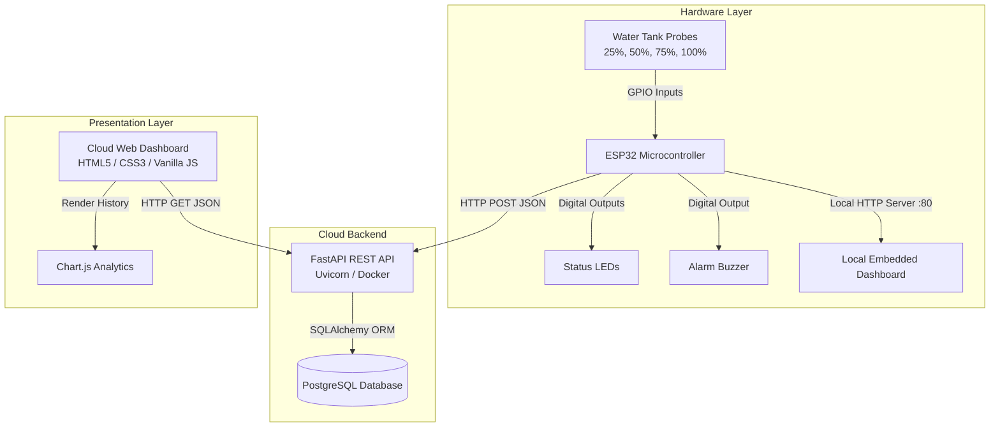

# ESP32 IoT Water Tank Monitoring System

An end-to-end Internet of Things (IoT) solution designed to monitor water storage levels in real time. The system integrates an ESP32 microcontroller with physical water-level probes, an asynchronous FastAPI backend containerized with Docker, a PostgreSQL relational database for sensor history, and a modern responsive web dashboard featuring live gauges and Chart.js analytics.

---

## 1. System Architecture



---

## 2. Technology Stack

- **Embedded Hardware & Firmware:**
  - Microcontroller: ESP32 Dev Module
  - Sensing: 4-probe resistive water-level detection (25%, 50%, 75%, 100%)
  - Firmware Language: Arduino C++
  - Local Server: ESP32 `WebServer` with embedded responsive single-page application in flash (`PROGMEM`)
- **Backend Service:**
  - Framework: Python 3.11 + FastAPI
  - ASGI Server: Uvicorn
  - Data Validation: Pydantic v2
  - ORM: SQLAlchemy 2.0
- **Database:**
  - Engine: PostgreSQL
- **Containerization & Deployment:**
  - Docker & Docker Compose
  - Cloud Platform: Render
- **Frontend Dashboard:**
  - Core: Semantic HTML5, CSS3, Vanilla Modern JavaScript
  - Data Visualization: Chart.js
- **Version Control:**
  - Git & GitHub

---

## 3. Project Directory Structure

```text
water_tank_esp32/
│
├── esp32/
│   └── water_tank_esp32.ino        # Original ESP32 Arduino sketch (unaltered)
│
├── backend/
│   ├── app/
│   │   ├── __init__.py             # Backend package initialization
│   │   ├── main.py                 # FastAPI application instance & middleware
│   │   ├── database.py             # SQLAlchemy engine & session dependency
│   │   ├── models.py               # Database table schemas
│   │   ├── schemas.py              # Pydantic request/response models
│   │   ├── crud.py                 # Query logic for sensor readings
│   │   └── routes/
│   │       ├── __init__.py
│   │       └── readings.py         # Endpoints: POST reading, GET latest, GET history
│   ├── requirements.txt            # Python dependencies
│   ├── Dockerfile                  # Production container definition
│   └── .env.example                # Template for database & server credentials
│
├── frontend/
│   ├── index.html                  # Cloud dashboard page
│   ├── css/
│   │   └── style.css               # Styling and responsive design
│   ├── js/
│   │   └── app.js                  # API polling and Chart.js integration
│   └── README.md                   # Frontend documentation
│
├── documentation/
│   └── README.md                   # Deep-dive firmware technical analysis & integration strategy
│
├── .gitignore                      # Git ignore rules for Python, environment, and build artifacts
└── README.md                       # Project master documentation
```

---

## 4. REST API Specification (Planned)

| Method | Endpoint | Description |
| :--- | :--- | :--- |
| `GET` | `/health` | Service health status and database connectivity check. |
| `POST` | `/api/readings` | Ingests a new water level reading from the ESP32. |
| `GET` | `/api/readings/latest` | Returns the most recent reading for live dashboard display. |
| `GET` | `/api/readings/history` | Returns historical readings (with optional limit query parameter). |

---

## 5. Development Status

- [x] **Phase 1: Project Structuring & Firmware Analysis**
  - Inspected existing Arduino firmware.
  - Organized modular repository structure.
  - Safely relocated `water_tank_esp32.ino` into `esp32/` without changing its contents.
  - Documented firmware pin assignments, debouncing, alarm rules, and integration considerations in `documentation/README.md`.
  - Configured `.gitignore` and environment template.
- [ ] **Phase 2: FastAPI Backend & PostgreSQL Storage**
- [ ] **Phase 3: Cloud Frontend Real-time Dashboard**
- [ ] **Phase 4: ESP32 HTTP Client Integration**
- [ ] **Phase 5: End-to-End Testing & Verification**
