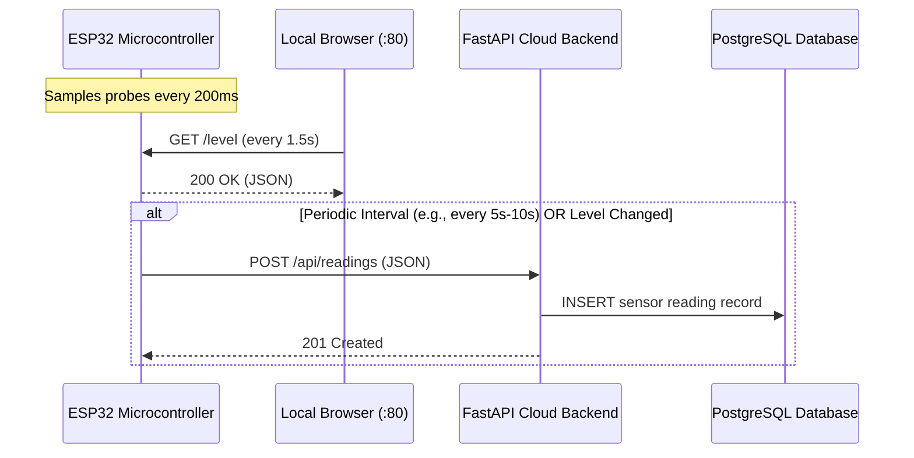

# Technical Analysis: ESP32 Water Tank Monitoring Firmware

## 1. Executive Summary

The existing firmware in `esp32/water_tank_esp32.ino` implements a standalone, Wi-Fi-enabled water level monitoring system. It reads water contact sensors through four discrete probes, drives visual status LEDs, triggers an audible buzzer alarm for boundary conditions (empty / full), and hosts an embedded web server providing a local real-time dashboard and alarm mute control.

This document provides a technical analysis of the firmware architecture, pin assignments, state management, and an integration strategy for sending sensor readings to a cloud-based FastAPI backend via HTTP POST without degrading local hardware responsiveness.

---

## 2. Hardware Architecture & Pin Assignments

| Peripheral | GPIO Pin | Configuration | Active State | Description |
| :--- | :---: | :--- | :--- | :--- |
| **Probe 25%** | `GPIO 5` | `INPUT_PULLUP` | `LOW` | Bottom sensor (25% level). Water contact closes circuit to GND. |
| **Probe 50%** | `GPIO 4` | `INPUT_PULLUP` | `LOW` | Mid-low sensor (50% level). |
| **Probe 75%** | `GPIO 16` | `INPUT_PULLUP` | `LOW` | Mid-high sensor (75% level). |
| **Probe 100%** | `GPIO 17` | `INPUT_PULLUP` | `LOW` | Top sensor (100% full / overflow). |
| **LED Below 25%** | `GPIO 13` | `OUTPUT` | `HIGH` | Red LED indicating critical empty state (<25%). Synchronously blinks at 100%. |
| **LED 25%–50%** | `GPIO 22` | `OUTPUT` | `HIGH` | Red LED indicating low water level. Synchronously blinks at 100%. |
| **LED 50%–75%** | `GPIO 21` | `OUTPUT` | `HIGH` | Yellow LED indicating normal level. Synchronously blinks at 100%. |
| **LED 75%–100%** | `GPIO 19` | `OUTPUT` | `HIGH` | Yellow LED indicating high-normal level. Synchronously blinks at 100%. |
| **LED 100% (Full)** | `GPIO 18` | `OUTPUT` | `HIGH` | Green LED indicating 100% capacity. Synchronously blinks at 100%. |
| **Buzzer** | `GPIO 23` | `OUTPUT` | `HIGH` | Audible buzzer active on level 0% and 100% unless muted. |

---

## 3. Sensor Reading & State Processing

### 3.1 Water Level Quantization
The function `readWaterPercentage()` checks probe inputs in descending order from highest to lowest:
1. `wire100` (`GPIO 17`) is `LOW` $\rightarrow$ Level = **100%**
2. `wire75` (`GPIO 16`) is `LOW` $\rightarrow$ Level = **75%**
3. `wire50` (`GPIO 4`) is `LOW` $\rightarrow$ Level = **50%**
4. `wire25` (`GPIO 5`) is `LOW` $\rightarrow$ Level = **25%**
5. None pulled `LOW` $\rightarrow$ Level = **0%** (Below 25%)

### 3.2 Debouncing Mechanism
- Water surfaces oscillate due to turbulence or ripples when tanks are being filled or drained.
- Probes are sampled every **200 ms** in `loop()`.
- A newly detected level (`candidate`) must be identical across **`STABLE_READS = 3`** consecutive samples ($3 \times 200\text{ ms} = 600\text{ ms}$) before transitioning the active global `level`.
- Transitioning to a new confirmed level automatically resets `buzzerMuted = false`, re-arming the buzzer alarm for subsequent threshold crossings.

### 3.3 Visual & Audible Alarm Logic
- **Alarm Condition:** `alarmActive()` returns `true` when `level == 0` (empty hazard) or `level == 100` (overflow hazard).
- **Buzzer:** Turned on (`digitalWrite(buzzerPin, HIGH)`) when `alarmActive() == true` and `buzzerMuted == false`.
- **LED Indicators:**
  - For levels 0%, 25%, 50%, and 75%, only the corresponding level LED remains constantly lit.
  - When `level == 100%`, all 5 LEDs synchronously flash at 2 Hz (`millis() / 250 % 2 == 0`) to provide high-visibility overflow warning.
  - `updateLEDs(level)` is evaluated on every iteration of `loop()`, ensuring smooth non-blocking flashing.

---

## 4. Local Web Server Architecture

The ESP32 runs `WebServer server(80)` providing three HTTP endpoints:
1. `GET /`: Returns `INDEX_HTML` stored in `PROGMEM` (flash memory). This serves a complete client-side dashboard with canvas rendering of the water tank, animated water surface waves, probe indicators, a 10-minute historical canvas chart, and an alarm mute button.
2. `GET /level`: Returns a JSON object with instantaneous state:
   ```json
   {
     "level": 75,
     "probes": [1, 1, 1, 0],
     "alarm": false,
     "muted": false
   }
   ```
3. `POST /mute`: Mutes the buzzer by setting `buzzerMuted = true` and `digitalWrite(buzzerPin, LOW)`.

---

## 5. Cloud Integration Strategy (HTTP POST to FastAPI)

### 5.1 Communication Flow


### 5.2 Proposed JSON Payload Format
To align with the backend database schema:
```json
{
  "water_level_percentage": 75,
  "probe_25": true,
  "probe_50": true,
  "probe_75": true,
  "probe_100": false,
  "alarm_active": false,
  "buzzer_muted": false
}
```

### 5.3 Technical Constraints & Solutions

1. **Non-blocking Execution:**
   - *Problem:* `HTTPClient.POST()` can block for hundreds of milliseconds or several seconds during network latency or DNS resolution. This would freeze `server.handleClient()`, delay probe sampling, and cause stuttering in the 100% LED blink animation.
   - *Solution:* Set low network timeouts (`client.setTimeout(2500)`), send POST requests on a non-blocking `millis()` timer (e.g., every 10 seconds or immediately upon state transition), and optionally leverage FreeRTOS tasks (`xTaskCreatePinnedToCore`) on Core 0 so network calls execute completely independent of Core 1 (which handles sensing and local dashboard).

2. **Cloud Cold Starts (e.g., Render Free Tier):**
   - *Problem:* Free cloud instances spin down after inactivity and may take up to 45 seconds to respond to the initial request.
   - *Solution:* The firmware must treat HTTP failures non-fatally, maintaining normal local operation without entering infinite blocking loops or watchdog resets.

3. **HTTPS / TLS Overhead:**
   - *Problem:* Cloud providers enforce HTTPS. The ESP32 `WiFiClientSecure` consumes extra memory for SSL/TLS handshakes.
   - *Solution:* Use `WiFiClientSecure` with `client.setInsecure()` (appropriate for educational IoT prototypes), or use a standard HTTP forwarder if available.

4. **Network Reconnection:**
   - *Problem:* Wi-Fi connection logic is currently handled only inside `setup()`. If the router restarts or connection drops, communication stops.
   - *Solution:* Implement non-blocking Wi-Fi reconnection checks in the loop or background task.

---

## 6. Conclusion

The existing firmware is well-structured, non-blocking in its core loop, and cleanly separates sensing from presentation. Extending it with an HTTP POST client requires minimal non-destructive additions that preserve all current local web server and hardware functionality.
